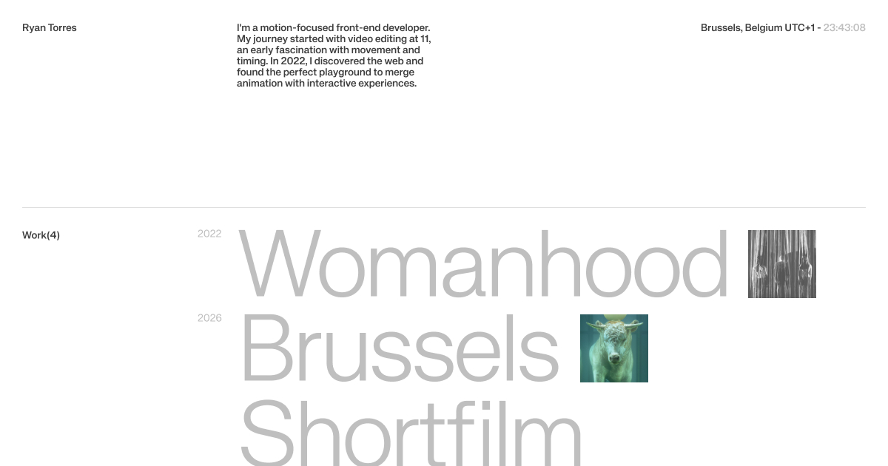

# Portfolio 2027



**Live site: [torres-ryan.com](https://www.torres-ryan.com)**

Personal portfolio of Ryan Torres, front end developer focused on motion and interaction, based in Brussels.

The projects it presents are school and personal projects, not client work.

## Stack

- **Next.js 16** with **React 19** and **TypeScript**
- **CSS Modules**, no CSS framework
- **GSAP 3** for animations, through `@gsap/react`
- **Lenis** for smooth scrolling, driven by GSAP's ticker
- **Sanity** as the CMS, with its Studio in `studio/`
- Site deployed on **Vercel**, Studio hosted by **Sanity**

## Highlights

- **Intro.** A text reveal with GSAP SplitText, played once per browser session.
- **Project pages.** Each project opens over the homepage and keeps its own URL. Opening that URL directly shows the full page.
- **Image transition.** The homepage thumbnail grows into the project image with GSAP Flip, and returns to its place on the way back.
- **Reduced motion.** Animations follow the `prefers-reduced-motion` setting.
- **Content.** Projects are edited in Sanity. Pages are static and refreshed in the background.

## Getting started

Requires Node.js 22 or 24 and npm 11.6.3 or later.

```bash
npm install
npm run dev      # development server on http://localhost:3000
npm run build    # production build
npm run lint     # ESLint
```

Copy `.env.example` to `.env.local` and fill in your Sanity project ID:

```
NEXT_PUBLIC_SANITY_PROJECT_ID=xxxxxxxx
NEXT_PUBLIC_SANITY_DATASET=production
```

The Studio is a separate app with its own dependencies:

```bash
cd studio
npm install
npm run dev      # http://localhost:3333
npm run deploy   # deploys the Studio to Sanity
```

## Project structure

```
src/
├── app/          pages, layout and global styles
├── components/   reusable components (intro, links, project modal…)
├── lib/          motion settings, transitions, project data
└── sanity/       Sanity client, queries and image helpers
studio/           Sanity Studio, a separate app
```

## AI use

I built this project with Claude Code. The Figma design, the choice of tools, the animations and the testing on real devices are mine. Claude Code wrote the code from those decisions, and I am responsible for the result.

## Credits

Typeface: KH Teka by [KH Type](https://khtype.com).

## Contact

[LinkedIn](https://www.linkedin.com/in/torres-ryan/) · [ryan-torres@outlook.com](mailto:ryan-torres@outlook.com)
